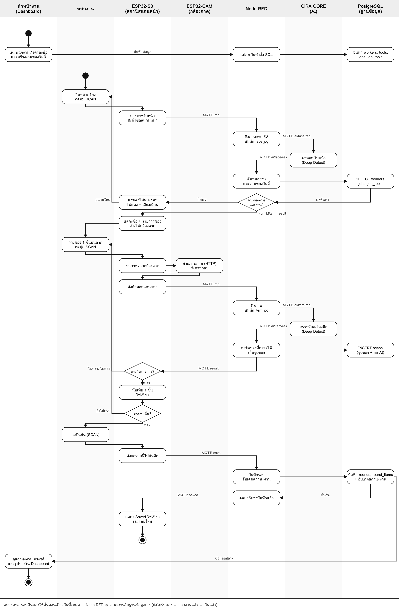

# Ready2Gear — สถานีตรวจเช็กเครื่องมือด้วย AI

โครงงานวิชา CPE447 · ทีม S&P888

Ready2Gear คือสถานีตรวจเครื่องมือก่อนออกงานและตอนคืนของ
พนักงานสแกนใบหน้าเพื่อดึงรายการเครื่องมือของงานวันนี้
จากนั้นวางเครื่องมือบนถาดทีละชิ้นให้ AI (CiRA CORE) ตรวจว่าตรงและครบตามรายการ
ผลทุกรอบถูกบันทึกลง PostgreSQL และหัวหน้างานดูสถานะงาน ประวัติ และรูปของได้จาก Dashboard



## สมาชิกและหน้าที่

| สมาชิก | ตำแหน่ง | หน้าที่ |
|---|---|---|
| พัชรนันท์ ส่งเสริม | Hardware & Embedded Developer | ต่อวงจรจอ TFT ปุ่ม LED บัซเซอร์ · โค้ด ESP32-S3 และ ESP32-CAM |
| พีรธัช รุ่งประทีปไพบูลย์ | System Integration & IoT Developer | ออกแบบ topic MQTT · เชื่อม ESP32 / CiRA / Node-RED · Flow ใน Node-RED · ประกอบกล่อง · ทดสอบทั้งระบบ |
| กรินทิพย์ ทองศรี | AI & Image Processing Engineer | เทรนโมเดลใบหน้าและเครื่องมือใน CiRA CORE · Workflow รับคำขอผ่าน MQTT |
| ธนภณ กลึงผล | Backend, Database & Dashboard Developer | ฐานข้อมูล PostgreSQL · เชื่อมต่อผ่าน Tailscale · Dashboard หัวหน้างาน |

## โครงสร้างระบบ

| ส่วน | อุปกรณ์ / ซอฟต์แวร์ | หน้าที่ |
|---|---|---|
| สถานีสแกนหน้า | ESP32-S3-CAM + จอ ILI9341 + ปุ่ม + LED + บัซเซอร์ | ถ่ายใบหน้า แสดงรายการของ รับปุ่ม แจ้งผล |
| กล้องถาด | ESP32-CAM (AI Thinker) | ถ่ายภาพของบนถาด เปิดไฟส่อง |
| ตัวกลาง | Node-RED (Docker) | รับคำขอ ดึงรูป ส่งให้ AI ค้นฐานข้อมูล ตอบบอร์ด บันทึกรอบ |
| AI | CiRA CORE (Deep Detect) | ตรวจใบหน้าและเครื่องมือ |
| ฐานข้อมูล | PostgreSQL (เชื่อมผ่าน Tailscale) | พนักงาน เครื่องมือ งาน ประวัติการตรวจ รูปของ |
| หน้าจอหัวหน้า | Node-RED Dashboard 2 | เพิ่มพนักงาน/เครื่องมือ สร้างงาน ดูประวัติพร้อมรูป |

### MQTT topics (broker.emqx.io, prefix `cpe477-peerach/`)

| Topic | จาก → ถึง | ข้อมูล |
|---|---|---|
| `req` | ESP32-S3 → Node-RED | `{cmd: face/item, request_id, image_url}` |
| `ai/face/req`, `ai/item/req` | Node-RED → CiRA | คำขอให้ตรวจรูป |
| `ai/face/res`, `ai/item/res` | CiRA → Node-RED | `{model, counts, best:{label,score}, request_id}` |
| `result` | Node-RED → ESP32-S3 | ชื่อพนักงาน + รายการของ หรือชื่อของที่ตรวจได้ |
| `save` | ESP32-S3 → Node-RED | ผลของรอบ (round_id, items) |
| `saved` | Node-RED → ESP32-S3 | ยืนยันว่าบันทึกแล้ว |

## โฟลเดอร์

```
firmware/FaceStation/   โค้ด ESP32-S3 (สแกนหน้า + จอ + ปุ่ม)
firmware/ItemCamera/    โค้ด ESP32-CAM (กล้องถาด)
node-red/node-red.json  Flow ทั้งหมด: แท็บ 1–3 (ระบบหลัก) + แท็บ 4 (Dashboard หัวหน้างาน)
database/schema.sql     โครงสร้างตาราง PostgreSQL + ข้อมูลตัวอย่าง
cira/cira.npj           โปรเจกต์ CiRA CORE (Workflow ใบหน้า + เครื่องมือ)
cira/cira_counts.js     โค้ดในบล็อก JavaScript ของ CiRA CORE
docs/                   System diagram (.png/.drawio) และแบบจัดวางกล่อง
```

## วิธีติดตั้ง

1. **ฐานข้อมูล**: สร้างฐานข้อมูลใน PostgreSQL แล้วรัน `database/schema.sql`
2. **Node-RED**
   ```
   docker run -d --name r2g-nodered -p 1880:1880 -v <โฟลเดอร์รูป>:/data/r2g nodered/node-red
   ```
   ติดตั้ง palette `node-red-contrib-postgresql` และ `@flowfuse/node-red-dashboard`
   แล้ว Import `node-red/node-red.json` ตั้ง Server ของโหนด PostgreSQL (SSL ปิด) แล้ว Deploy
   Dashboard อยู่ที่ `http://<IP>:1880/dashboard`
3. **CiRA CORE**: เปิด `cira/cira.npj` (ไฟล์โมเดล .weights ไม่ได้อยู่ใน repo เพราะขนาดใหญ่) หรือสร้าง 2 Workflow
   `Mqtt Sub (ai/face/req) → Image File (face.jpg) → Deep Detect → JavaScript → Mqtt Pub (ai/face/res)`
   และแบบเดียวกันสำหรับ item ใส่โค้ด `cira/cira_counts.js` ในบล็อก JavaScript (ตั้ง `MODEL`)
4. **บอร์ด**: แก้ `ssid`, `password` และ `itemCamBase` (IP ของ ESP32-CAM)
   อัปโหลดด้วย Arduino IDE · ESP32-S3 ต้องตั้ง **Tools → PSRAM → OPI PSRAM**

## ข้อควรรู้

- `face_label` และ `cira_label` ในฐานข้อมูลต้องสะกดตรงกับชื่อคลาสในโมเดล CiRA
- ระบบไม่เก็บรูปใบหน้า เก็บเฉพาะรูปเครื่องมือในตาราง `scans`
- รอบคืนของใช้ขั้นตอนเดียวกัน Node-RED ดูสถานะงานเอง (assigned → out → returned)
